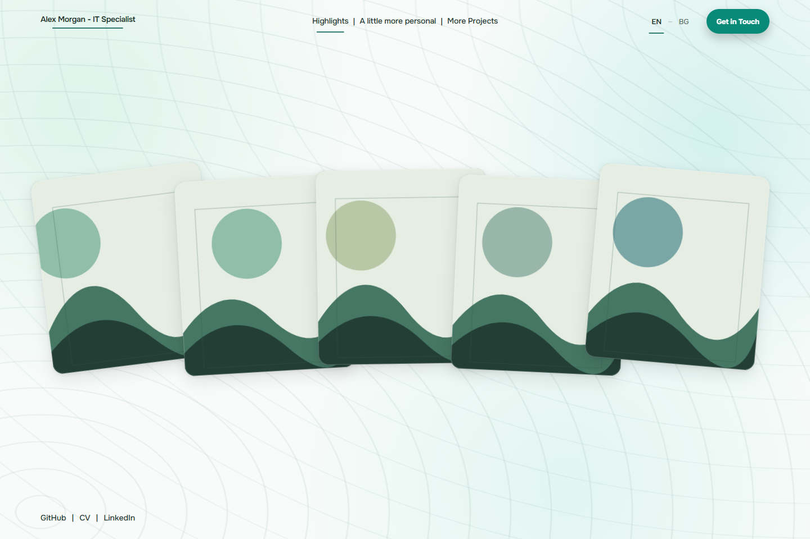

# Vue Editorial Portfolio Template

A portfolio template for developers, designers, and other creatives who want to tell the story behind their work. Visitors can explore your projects, career, and interests through an interactive deck of illustrated cards. Start with a complete example, then make it yours with your own writing, images, and links.

## Why use this template?

- **An interactive first impression.** Five illustrated cards lead to dedicated pages, with animated transitions connecting the homepage to each story.
- **Designed for phones as well as desktops.** The card layout adapts to narrow screens, with visible labels on mobile so visitors can choose a section by touch.
- **Room for the story behind each project.** A project showcase pairs previews with descriptions, while a career timeline makes it easy to browse roles, education, and skills.
- **English and Bulgarian built in.** Visitors can switch languages on the site, and their choice is remembered for the next visit.
- **Ready to personalize and host.** Sample content and artwork give you a starting point. Vue 3 and Vite produce a static site, and the included GitHub Actions workflow can publish your copy to GitHub Pages.

## Preview

[](https://sureebi.github.io/Portfolio-template/)

See a customized version of the template in use on a real portfolio at [slavislaveev.com](https://slavislaveev.com/).

## Run locally

```sh
npm ci
npm run dev
```

Run `npm run build` for the default production build, or `npm run build:pages` for GitHub Pages.

## Make it your own

On GitHub, select **Use this template → Create a new repository**. Clone your new repository and follow the local setup above. Edit both the `en` and `bg` versions when changing bilingual content.

1. **Name and biography.** In [`useLanguage.js`](src/composables/useLanguage.js), replace the sample name in the site header and browser titles. Update the introduction in [`AboutIntroView.vue`](src/views/AboutIntroView.vue) and the personal and beyond-work copy in `useLanguage.js`. Replace or remove sample press links in [`BeyondWorkView.vue`](src/views/BeyondWorkView.vue).
2. **Experience and projects.** In [`highlightPageContent.js`](src/data/highlightPageContent.js), update the career timeline, education, skills, showcase projects, and next steps. Edit [`MoreProjectsView.vue`](src/views/MoreProjectsView.vue) for additional project cards and company names, and `useLanguage.js` for their translated labels and descriptions.
3. **Photos and artwork.** Put portraits and card images in [`src/assets/highlights/`](src/assets/highlights/) and project screenshots in [`src/assets/projects/`](src/assets/projects/). Update the imports in [`HighlightsShowcase.vue`](src/components/HighlightsShowcase.vue) for the home cards, [`AboutIntroView.vue`](src/views/AboutIntroView.vue) and [`PersonalView.vue`](src/views/PersonalView.vue) for portraits, and [`HighlightPageView.vue`](src/views/HighlightPageView.vue) for project previews. For example, add `portrait.webp` to `src/assets/highlights/` and change the import in `AboutIntroView.vue` to `import portrait from '../assets/highlights/portrait.webp'`. Update any image descriptions to match.
4. **Contact and links.** In [`App.vue`](src/App.vue), replace all three occurrences of `hello@example.com` so the displayed address, copy button, and email link agree. Replace the footer's GitHub, CV, and LinkedIn URLs. Search for `example.com` to find any remaining demo links.
5. **Site details and final check.** Update the title and search description in [`index.html`](index.html), the localized browser titles in `useLanguage.js`, and [`public/favicon.svg`](public/favicon.svg). Run `npm run dev`, switch between both languages, open each page, and check the layout on a narrow screen. Run `npm run build` before publishing.

## Optional: Deploy your copy to GitHub Pages

For a project site such as `https://username.github.io/my-portfolio/`, change `/Portfolio-template/` to `/my-portfolio/` in [`vite.config.js`](vite.config.js). For a site hosted at the domain root, use `/`. Then open **Settings → Pages** in your own repository and set **Source** to **GitHub Actions**. Push to `main` or run **Deploy portfolio to GitHub Pages** from the **Actions** tab. The Pages build uses links such as `/my-portfolio/#/personal` so individual pages can be opened directly and refreshed.

[GitHub Pages demo](https://sureebi.github.io/Portfolio-template/)

Other hosts can use the default build with a fallback to `index.html` for Vue Router history URLs.

## License

MIT. See [LICENSE](LICENSE).
